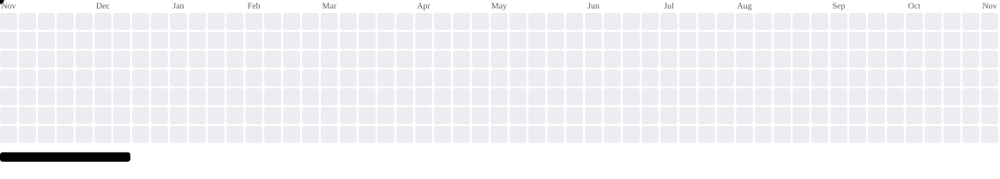

<h1 align="center">
  
</h1>

  AI &amp; Data Science Undergraduate · ML Engineer &amp; Model Deployment

 

### Tech stack

  
  
  
  
  
  
  
  
  
  
  
  
  
  
  

 

### Activity

<picture> <source media="(prefers-color-scheme: dark)" srcset="https://raw.githubusercontent.com/anuarkenzh1bekov/anuarkenzh1bekov/output/breakout-contribution-graph-dark.svg"> <source media="(prefers-color-scheme: light)" srcset="https://raw.githubusercontent.com/anuarkenzh1bekov/anuarkenzh1bekov/output/breakout-contribution-graph.svg">  </picture>

